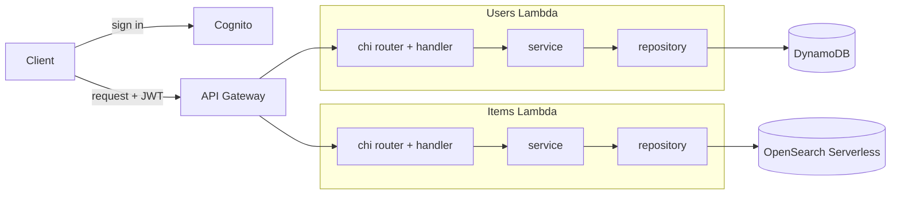

# Go Serverless Microservices

Two small Go services on AWS Lambda, structured so a new domain is a new folder and swapping a datastore touches one file.

Built in September 2025 as a hand-written reference for layered Go on Lambda. It is a compact boilerplate, not a finished product, and the limitations are listed at the bottom.

## Problem and solution

Serverless Go examples tend to be one `main.go` with the database calls inline. That is fine for a demo and painful by the third endpoint.

This repo keeps each service as a thin Lambda entry point over a normal layered package (route, handler, service, repository). The same `chi` router runs under Lambda or as a plain HTTP server on `:8080`, so you can iterate locally without deploying.

## Architecture



Each service has its own binary under `cmd/`. The handler decodes and validates the request, reads the user id from the JWT `sub` claim, and calls the service. The service talks to a repository interface; the only implementation per domain is DynamoDB (users) or OpenSearch (items).

API Gateway and Cognito are shown because that is the intended deployment. Neither is defined in this repo (no IaC), see the limitations below.

## Stack

- Go 1.25, `chi` router, `aws-lambda-go` with the `aws-lambda-go-api-proxy` chi adapter
- AWS SDK for Go v2: DynamoDB for user profiles, OpenSearch (SigV4-signed, service `aoss`) for product geo search
- `go-playground/validator` for request validation, `golang-jwt` to read the token claims
- `godotenv` for local configuration

## Design decisions and trade-offs

- **One router, two runtimes.** Lambda events are adapted into a `chi` router, and `LOCAL=true` swaps the adapter for `http.ListenAndServe`. Handlers are ordinary `net/http` code, which keeps them easy to run and debug locally. The cost is a small adapter layer and some cold-start overhead compared with a bare Lambda handler.
- **One Lambda per domain, not one per route.** `users` and `items` deploy and scale separately and can use different datastores. A per-route split would give finer isolation but a lot more functions to wire up for a boilerplate this size.
- **Repository as an interface, owned by the domain.** Services depend on a small `Repository` interface defined next to them. The AWS client setup lives in `internal/db/`, and attribute mapping stays in `repo.go`, so a datastore change is local. Go-style interfaces on the consumer side also make services straightforward to fake in tests (none are written yet).
- **Different stores for different access patterns.** User profiles are a key lookup by id, which suits DynamoDB. Products need distance queries, which suits a search engine. This avoids bending one database to do both, at the cost of two things to operate and a clear cost warning: OpenSearch is the expensive part of this setup.
- **Identity comes from the token, not the request body.** The user id is taken from the Cognito JWT `sub` claim, so a client cannot write another user's profile by sending a different id.
- **`internal/` for everything.** Domain code and DB wiring are not importable from outside the module, which keeps the public surface at zero and refactors cheap.

## Run it locally

Prerequisites: Go 1.25+, AWS credentials with access to the resources below.

There is no local emulator wired in, so even local runs talk to real AWS.

1. Create a DynamoDB table whose partition key is a string attribute named `Id`.
2. (Items service only) Create an OpenSearch Serverless collection. The client signs requests for the `aoss` service, and creates the index at startup if it is missing.
3. Create a `.env` file in the repo root:

   ```env
   AWS_ACCESS_KEY_ID=...
   AWS_SECRET_ACCESS_KEY=...
   AWS_REGION=...
   LOCAL=true
   USERS_TABLE=users
   OPEN_SEARCH_END_POINT=https://your-collection-endpoint
   OPEN_SEARCH_INDEX=products
   ```

4. Start a service (both listen on `:8080`, so run one at a time or change the port):

   ```sh
   go run ./cmd/users
   go run ./cmd/items
   ```

5. Call it with a Cognito ID token as a Bearer token:

   ```sh
   curl -X POST http://localhost:8080/user \
     -H "Authorization: Bearer $ID_TOKEN" \
     -H "Content-Type: application/json" \
     -d '{"name":"john","email":"doe@example.com","ratings":4.5,"userType":"renter"}'

   curl http://localhost:8080/user -H "Authorization: Bearer $ID_TOKEN"
   ```

Routes: `POST /user`, `GET /user`, `POST /product`, `GET /product?lat=..&lng=..`.

To get an ID token for a test user, create a Cognito user pool and app client with `USER_PASSWORD_AUTH` enabled, then call `InitiateAuth` and use the returned `IdToken`.

### Deploy

There is no deploy script. The manual path is to build a Linux binary and upload it as a Lambda that uses the `provided.al2023` runtime (the binary must be named `bootstrap`), behind API Gateway:

```sh
GOOS=linux GOARCH=arm64 go build -tags lambda.norpc -o bootstrap ./cmd/users
zip function.zip bootstrap
```

Leave `LOCAL` unset in Lambda and set `USERS_TABLE` (or the OpenSearch variables) as function environment variables. Match the architecture flag to the Lambda architecture you choose. I have not included deployment automation.

## Project layout

```text
cmd/
  users/main.go        Lambda / local entry point for the users service
  items/main.go        Lambda / local entry point for the items service
internal/
  users/               route.go, handler.go, service.go, repo.go, model.go, type.go
  items/               same shape, backed by OpenSearch
  db/dynamo/           DynamoDB client constructor
  db/openSearch/       SigV4-signed OpenSearch client, index bootstrap
```

## Limitations and next steps

This is a boilerplate, not a production system. Known gaps:

- **JWT signature is not verified in the service.** The handlers read `sub` with `ParseUnverified`, so they assume API Gateway (for example a Cognito authorizer) has already rejected bad tokens. Without that in front, the services can be spoofed. Verifying against the Cognito JWKS in code is the first fix.
- **No tests.** The repository interfaces were designed for faking, but no unit or integration tests exist yet.
- **No infrastructure as code or CI.** Cognito, API Gateway, tables and Lambdas are set up by hand. A CDK or Terraform stack is the obvious next step.
- **Items search is a first cut.** The geo query targets a `location` field, while documents are stored with separate `lat` and `lng`, there is no explicit index mapping, `name` and `details` filters are parsed but not used in the query, and the response is not yet unwrapped from the search `hits` envelope. Treat `GET /product` as unfinished.
- **Thin validation and errors.** Request structs have no validator tags yet, and handlers return plain-text errors with a generic 500 for service failures.
- **Event-driven pieces are not built.** SNS, SQS and DynamoDB Streams are on the wish list, not in the code.

## Write-up

The reasoning behind the structure is in the article: [Go Serverless Microservices: A Clean Architecture Boilerplate for Go Developers](https://blog.stackademic.com/go-serverless-microservices-a-clean-architecture-boilerplate-for-go-developers-474fc1c9c792).

## License

MIT, see [LICENSE](./LICENSE).

---

Built by Usman Ali Siddiqui · [maanizstudio.com](https://www.maanizstudio.com)
